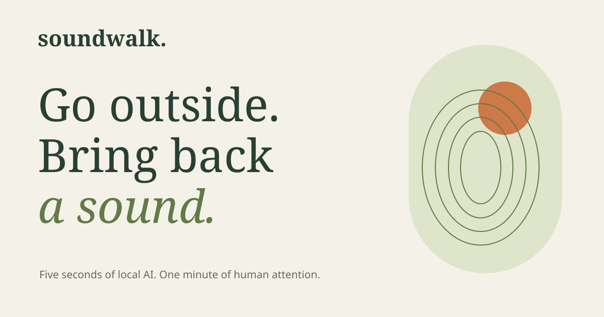

# SoundWalk

**Five seconds of local AI. One minute of human attention.**

[Take a soundwalk](https://blucca.github.io/soundwalk/) · [Watch the 77-second film](https://blucca.github.io/soundwalk/demo/) · [How it works & credits](https://blucca.github.io/soundwalk/about.html)



Pause on a doorstep, a park bench, or a patch of shade. Catch five seconds of sound. Follow one thing you hear for a minute. Bring back one observation in your own words.

SoundWalk is a small, phone-first web experience made for the **DEV Hacktoberfest Open-Source AI Challenge, Week 1: Touch Grass**. YAMNet gives the walk a context-sensitive starting point; the listener chooses what to follow and writes the final observation.

## The experience

1. **Get ready.** The first preparation brings approximately 18 MB of app, open model, and sample assets onto your device.
2. **Catch a sound.** A user-triggered microphone records five seconds into memory.
3. **Choose a thread.** Local YAMNet suggests broad groups: birds, water, wind, street rhythms, or life nearby. An open invitation is available for every recording.
4. **Give it a minute.** A concrete listening task appears, the page dims, and a foreground timer runs for 60 seconds. Switching tabs pauses the minute. A soft chime marks completion.
5. **Keep a little wonder.** Write an observation, optionally name the place, and save a sound card. Export it as a PNG or share the words.

The **shoreline sample** carries its source label through selection, the looping listening rehearsal, saved notes, and exported images. It uses a licensed five-second sea-wave recording by HerbertBoland via ESC-10. Microphone cards identify their input as a device recording. The listener supplies the place and observation.

## How the open AI is used

```text
User opens microphone
  → AudioWorklet: 5 seconds of PCM, input track stops
  → mono 16 kHz windowed-sinc resampling
  → Web Worker / TensorFlow.js CPU / Apache-2.0 YAMNet
  → mean scores across frames, 521 AudioSet labels
  → broad listening suggestions
  → human choice → authored one-minute invitation
  → human observation → local sound card
```

The model runs on the device. Per-recording tensors are disposed after inference, and audio stays in memory during that flow. A group's matching score uses its strongest member label; related labels share one group. Weak or silence-dominant matches lead to an open listening invitation. The model's suggestions and the listener's written observation remain separate data fields.

CPU inference lives in a Web Worker so the interface remains responsive. Task text is authored in [`web/audio.mjs`](web/audio.mjs). Changing a category or invitation is a small, reviewable edit.

## Offline and local storage

After the footer says **“Ready for an offline soundwalk,”** the application, TF.js, model graph, four weight shards, labels, and sample are cached in that browser. The application stores the latest 50 cards in local storage. Clearing site data clears that collection. Exported images are ordinary local files.

The application's network requests load its own static assets from GitHub Pages. Microphone input, model inference, and card creation execute in the browser. A foreground tab is required during recording and listening. Screen wake lock is used where the browser supports it.

## Run and modify

Serve `web/` from localhost or HTTPS. For example, from this repository:

```sh
python3 -m http.server 8080 --bind 127.0.0.1 --directory web
# Open http://127.0.0.1:8080
```

Native ES modules and browser APIs supply the application runtime. The checked-in model and TF.js files make the inference path reproducible.

```sh
npm run check
```

This runs focused audio tests and verifies model hashes, licensing provenance, and the complete offline asset graph. [GitHub Actions](https://github.com/blucca/soundwalk/actions) runs these checks before publishing the static experience to Pages. The workflow is part of the product delivery: changing or dropping a weight shard stops publication.

## Development evidence

[The narrated browser film](https://blucca.github.io/soundwalk/demo/) follows real local inference, an edited view of a complete sixty-second sample rehearsal, a clearly labeled scripted observation, and image export. English captions, [transcript](docs/demo-transcript.md), and original sample credits accompany the film. Also available on [YouTube](https://youtu.be/757q9l9g0uQ).

The [browser check](docs/validation.md) covers a complete 60-second sample rehearsal, PNG export, persistence, and an offline microphone flow using a file-backed microphone simulation. The first shipped-app sample inference took **4.23 seconds** in Chromium 153 on Linux; the microphone-path inference took **4.52 seconds**. Phone-sized layouts were exercised at 390 px and 320 px.

## Licenses and provenance

- **Application, invitation text, and artwork:** MIT, © 2026 Blucca.
- **YAMNet and TensorFlow.js:** Apache License 2.0, Google / TensorFlow authors.
- **Sea-wave sample:** HerbertBoland, “Branding_kort.wav,” Freesound #28135, via ESC-10 clip `1-28135-A-11.wav`, CC BY 3.0. Inference resamples the dataset excerpt; rehearsal playback loops it.

See [LICENSES.md](LICENSES.md) and the [machine-readable asset provenance](web/model/provenance.json) for source links, exact hashes, and retained license texts.

Built by **Blucca with an AI coding agent**, October 2026. [Specific observations and issues](https://github.com/blucca/soundwalk/issues) are welcome: browser, sound you heard, suggestion you saw, and what you noticed during the minute.
