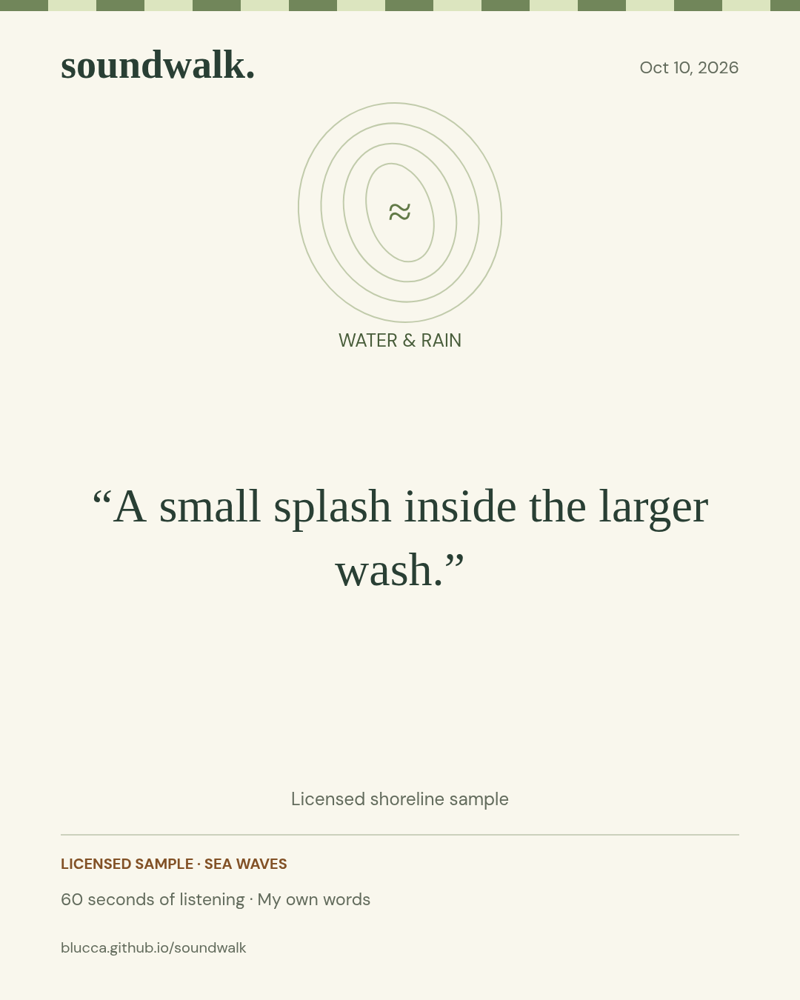

# Browser check — October 10, 2026

## Setup

- Chromium 153 on Linux; TensorFlow.js 4.22.0, CPU backend in a Web Worker.
- Viewports: 1440 px desktop; 390 px and 320 px phone-sized layouts.
- Audio input: the licensed ESC-10 sea-wave sample. The microphone-path check used Chromium's file-backed microphone simulation with the same recording.
- Written observations: scripted demonstration text entered by browser automation.

## Observed flows

| Check | Result |
| --- | --- |
| Bundled sample → actual YAMNet → water invitation | Passed. Ocean 0.721; Waves, surf 0.676; Water 0.663. First inference: 4.23 s. |
| Sample rehearsal → full 60-second timer → observation card | Passed. Sample source retained on the card. |
| Pause and resume | Displayed remaining time held during the pause. |
| Save image | A 1080 × 1350 PNG was downloaded. |
| Browser reload | Saved card remained in local field notes. |
| Offline reload → microphone API → AudioWorklet → YAMNet → card | Passed with browser networking set offline. First inference: 4.52 s. |
| Microphone lifetime | Input track state was `ended` before category selection. |
| Human category choice | Water was suggested; Wind was selected. Both remained distinct on the saved card. |
| Finish early | The saved card recorded the actual shorter duration. |
| Phone-sized layout | Page width matched viewport width at 390 px and 320 px. |
| Page JavaScript errors | 0 in the complete-flow check. |
| Application requests | Static-asset GETs to the application origin. |

The final typography and exported sample card received a separate visual check after the complete-flow run. The demonstration card is reproduced below; its observation is an authored example.



## Repeat the checks

Serve `web/` on localhost, open the shoreline sample, and complete its minute. Save a card and reload. Once the footer reads “Ready for an offline soundwalk,” switch the browser's network to offline and reopen the page. Record five seconds, choose a category, and save another card.

For the microphone simulation, Chromium can use:

```text
--use-fake-ui-for-media-stream
--use-fake-device-for-media-stream
--use-file-for-fake-audio-capture=/absolute/path/to/web/audio/sea-waves.wav
```

A physical outdoor session adds its own evidence: device/browser, the actual sound heard, the selected invitation, and the listener's observation. Those records are kept separately from this automated development check.
